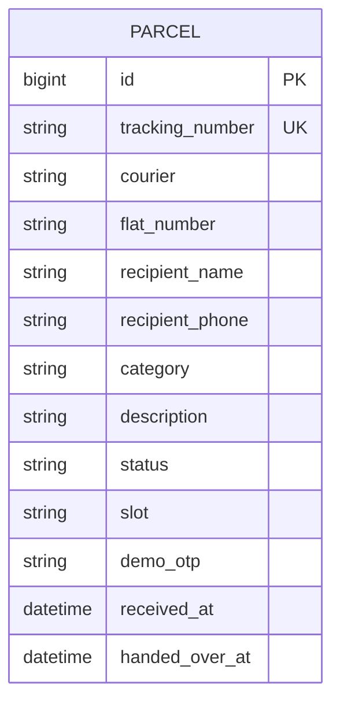

# Database Design

The SmartParcel database uses a `parcels` table managed by Spring Data JPA and Hibernate with MySQL 8.0.

| Field | Type | Description |
|---|---|---|
| id | BIGINT, PK | Auto-generated parcel ID |
| tracking_number | VARCHAR(80), UNIQUE | Courier tracking / AWB reference number |
| courier | VARCHAR(60) | Courier company (Amazon, Flipkart, Delhivery, BlueDart, DTDC, India Post) |
| flat_number | VARCHAR(30) | Apartment / flat identifier (e.g., A-101) |
| recipient_name | VARCHAR(100) | Resident full name |
| recipient_phone | VARCHAR(25) | Resident contact number |
| category | VARCHAR(50) | Package category (Box, Fragile, Document, Electronics, Apparel, Perishable) |
| description | VARCHAR(250) | Inward parcel notes or remarks |
| received_at | DATETIME | Timestamp when parcel was registered at gate desk |
| handed_over_at | DATETIME | Timestamp when handover was confirmed with OTP |
| slot | VARCHAR(100) | Resident-selected collection/delivery time window |
| status | VARCHAR(30) | Current lifecycle stage: `RECEIVED`, `SLOT_BOOKED`, or `HANDED_OVER` |
| demo_otp | VARCHAR(10) | Secure 6-digit demonstration OTP |

---

## Entity-Relationship & Modular Structure

## Relationships & Future Extensions
In an enterprise deployment, `resident`, `staff`, `apartment_block`, `flat`, `parcel`, `delivery_slot` and `handover_audit` can be decomposed into dedicated normalized entities with foreign keys and multi-tenant isolation.
