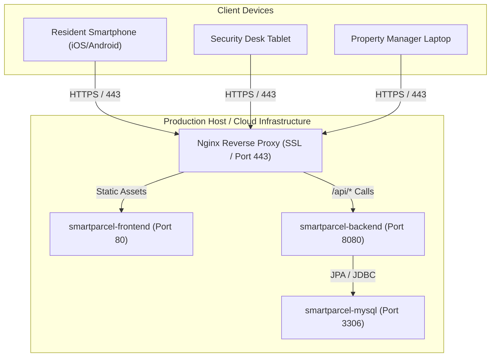

# SmartParcel OS – Enterprise Deployment Manual

This guide covers deployment options for **SmartParcel** ranging from 1-click cloud hosting (for instant live client demonstrations on mobile and desktop) to containerized production deployment on dedicated cloud servers.

---

## Deployment Architecture Overview



---

## Option 1: Instant Cloud Deployment (Railway / Render)
*Best for: Giving your client an immediate, public, HTTPS link (`https://smartparcel-client.up.railway.app`) to test directly on their phone and laptop.*

### Deploying on Railway (Recommended for Ease)
1. Push your repository to **GitHub**:
   ```bash
   git init
   git add .
   git commit -m "Initial commit for client demo"
   git branch -M main
   git remote add origin https://github.com/your-username/smartparcel.git
   git push -u origin main
   ```
2. Log into **[Railway.app](https://railway.app)**:
   * Click **New Project** $\rightarrow$ **Provision MySQL**.
   * Copy the MySQL connection parameters (`MYSQL_URL`, `MYSQLUSER`, `MYSQLPASSWORD`).
3. Click **Add Service** $\rightarrow$ **GitHub Repo** $\rightarrow$ Select your repository:
   * Set Root Directory to `/backend`.
   * Under **Variables**, add:
     * `SPRING_DATASOURCE_URL` = `${{MySQL.MYSQL_URL}}`
     * `SPRING_DATASOURCE_USERNAME` = `${{MySQL.MYSQLUSER}}`
     * `SPRING_DATASOURCE_PASSWORD` = `${{MySQL.MYSQLPASSWORD}}`
4. Add another service for `/frontend`:
   * Set Root Directory to `/frontend`.
   * Set `VITE_API_URL` to your backend's public URL (e.g., `https://smartparcel-backend.up.railway.app/api/parcels`).
5. **Result**: You receive two live HTTPS URLs:
   * Frontend: `https://smartparcel-frontend.up.railway.app`
   * Backend: `https://smartparcel-backend.up.railway.app`

---

## Option 2: Docker Compose on Linux VPS (DigitalOcean / AWS / Linode)
*Best for: Full production deployment under your own custom domain (e.g., `app.smartparcel.com`).*

### Prerequisites:
* A virtual private server running Ubuntu 22.04 LTS or 24.04 LTS.
* Docker and Docker Compose installed:
  ```bash
  sudo apt update && sudo apt install -y docker.io docker-compose-v2
  sudo systemctl enable --now docker
  ```

### Step 1: Clone Repository onto the Server
```bash
git clone https://github.com/your-username/smartparcel.git
cd smartparcel
```

### Step 2: Configure Environment Variables
Verify your `docker-compose.yml` credentials (default: `MYSQL_ROOT_PASSWORD=rootpassword`).

### Step 3: Launch Containers
```bash
sudo docker compose up -d --build
```
Verify all 3 containers are healthy:
```bash
sudo docker compose ps
```
Output:
```text
NAME                   STATUS                   PORTS
smartparcel-mysql      Up (healthy)             0.0.0.0:3306->3306/tcp
smartparcel-backend    Up                       0.0.0.0:8080->8080/tcp
smartparcel-frontend   Up                       0.0.0.0:80->80/tcp, 0.0.0.0:5173->80/tcp
```

### Step 4: Configure Free SSL Certificate with Let's Encrypt (Certbot)
If you point a domain (e.g., `smartparcel.yourdomain.com`) to the server IP:
```bash
sudo apt install -y certbot python3-certbot-nginx
sudo certbot --nginx -d smartparcel.yourdomain.com
```

---

## Option 3: Local / On-Premise Apartment Gate Deployment
*Best for: Running on a computer inside the apartment security office without requiring internet cloud access.*

1. **Launcher**:
   * Double-click **`start_all.bat`** on the security office Windows machine.
   * Both the local MySQL server and Spring Boot API start automatically.
2. **Accessing via Local Wi-Fi on Tablets and Phones**:
   * Find the machine's local IP address (`ipconfig` $\rightarrow$ e.g., `192.168.1.100`).
   * Security guard tablets and resident phones connected to the apartment Wi-Fi can navigate directly to:
     ```text
     http://192.168.1.100:5173
     ```
3. **Shutdown**:
   * Double-click **`stop_all.bat`** to gracefully terminate all background processes.

---

## Database Backup & Recovery

### Automated Backup Command:
To take a full SQL dump of community parcel data:
```bash
mysqldump -u root -p smartparcel > smartparcel_backup_$(date +%F).sql
```

### Restore Database:
```bash
mysql -u root -p smartparcel < smartparcel_backup_2026-11-10.sql
```

